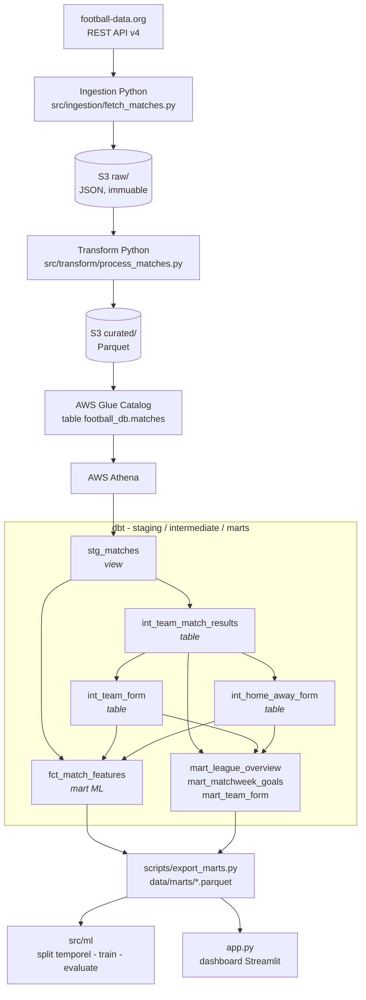

# Football Pipeline — ETL + ML sur les 5 grands championnats européens

🇫🇷 Français | 🇬🇧 [English](README.md)

[](https://gitlab.com/axelcorral-group/football-pipeline/-/pipelines)
[](https://gitlab.com/axelcorral-group/football-pipeline/-/pipelines)

Pipeline ELT complet qui collecte les données de matchs de **5 championnats européens** via l'API football-data.org, les dépose sur **AWS S3**, les catalogue dans **Glue**, les transforme avec **dbt sur Athena** en couches staging / intermediate / marts, puis entraîne un modèle de **prédiction de résultat** (victoire domicile / nul / victoire extérieur) exposé dans un **dashboard Streamlit** déployable sans credentials AWS.

> Ce projet n'a pas pour but de prédire le football avec précision — le modèle est volontairement simple et son accuracy (43–49 %) reste proche d'une baseline naïve. Son objectif est de démontrer l'**industrialisation d'un pipeline data de bout en bout** avec les pratiques d'ingénierie attendues en production.

## Live Demo

**https://football-pipeline-axel.streamlit.app**

Le dashboard fonctionne entièrement hors-ligne : il lit les marts dbt exportés en Parquet et versionnés dans le repo (`data/marts/`), plus les modèles pré-entraînés de `models/`. Aucun credential AWS à l'exécution.

## Architecture



Le partage est volontaire. Python garde tout ce qui parle au monde extérieur —
appels API, retry, rate limit, écriture S3 — et tout ce qui relève réellement de
la modélisation : split temporel, entraînement, évaluation, inférence. dbt garde
tout ce qui est une requête : typage, nettoyage, déduplication, règle H/D/A,
historique par équipe, fenêtres glissantes, dataset de features, datasets
analytics — avec les tests, le lineage et la documentation qui vont avec.

**Orchestrateur :** `python -m src.main` (avec `--competition`, `--season`, `--dry-run`)
**Couche de transformation :** `dbt build --project-dir dbt` — 8 modèles, 138 tests
**Stages GitLab CI/CD :** `lint` → `dbt` → `test` → `model` → `build` → `deploy`

## Résultats ML — saison 2025/26

Modèle retenu : meilleur entre Logistic Regression et Random Forest, split **temporel 80/20 (aucun shuffle)**. Chiffres issus de `models/metrics.json`.

| Championnat | Code | Modèle | Accuracy | Baseline (toujours H) | Gain | Log loss | Brier | n |
|---|---|---|---:|---:|---:|---:|---:|--:|
| Premier League | PL | Logistic Regression | 43.1 % | 42.6 % | +0.4 pt | 1.085 | 0.655 | 360 |
| Ligue 1 | FL1 | Logistic Regression | 46.6 % | 46.1 % | +0.5 pt | 1.056 | 0.642 | 286 |
| Bundesliga | BL1 | Logistic Regression | 46.6 % | 43.8 % | +2.8 pt | 1.080 | 0.651 | 288 |
| Serie A | SA | Logistic Regression | 48.6 % | 38.9 % | +9.7 pt | 1.057 | 0.637 | 356 |
| La Liga | PD | Logistic Regression | 49.3 % | 48.9 % | +0.3 pt | 1.009 | 0.605 | 355 |
| Toutes ligues | all | Logistic Regression | 44.1 % | 44.0 % | +0.1 pt | 1.053 | 0.635 | 1645 |

> La prédiction de résultats de football est un problème difficile. Seule la Serie A montre un gain net ; ailleurs le modèle apporte un gain marginal. Le log loss reste juste en dessous de ln(3) ≈ 1.099 : les probabilités affichées sont à peine plus informatives qu'un tirage uniforme. L'intérêt du projet est le pipeline et le cycle de vie ML, pas la performance absolue du modèle. Voir [`models/model_card.md`](models/model_card.md) pour le détail des features, performances et limites.

> **Le passage des features à dbt ne les a pas changées.** Sur les 1 751 matchs communs aux deux implémentations, les six features glissantes produites en SQL sont identiques à 1e-9 près à celles de pandas. Les écarts d'accuracy face à l'exécution précédente (Bundesliga 43.1 % → 46.6 %, toutes ligues 44.7 % → 44.1 %) viennent d'un seul changement : les lignes sont triées par `(match_date, match_id)` et non par la seule date, ce qui déplace la frontière du split 80/20 quand plusieurs matchs partagent le même coup d'envoi — six d'un coup en Bundesliga. Le tri est maintenant total, donc le découpage est reproductible.

## Données

| Paramètre | Valeur |
|-----------|--------|
| Source | football-data.org API v4 (free tier) |
| Compétitions | PL, FL1, BL1, SA, PD |
| Saison | 2025/26 |
| Volume | 1 752 matchs après déduplication, 1 645 lignes exploitables après features |
| Stockage brut | S3 `raw/` — JSON par compétition/date (immuable) |
| Stockage curé | S3 `curated/` — Parquet partitionné par saison |
| Transformation | dbt sur Athena — 8 modèles, 138 tests de qualité |
| Instantané curé | `data/cache/matches_all_2025.parquet` (source dbt de la cible `dev`) |
| Marts exportés | `data/marts/*.parquet` — ce que lisent le dashboard et l'entraînement |

## Stack

| Composant | Technologie |
|-----------|-------------|
| Langage | Python 3.12 · SQL |
| AWS | S3 · Glue Catalog · Athena |
| Transformation | dbt-core 1.11 · dbt-athena · dbt-duckdb · dbt_utils |
| AWS SDK | boto3 |
| Data | pandas · pyarrow (Parquet) · DuckDB (cible dbt locale) |
| ML | scikit-learn · joblib |
| Dashboard | Streamlit · Plotly |
| Tests | pytest · coverage ≥ 70 % |
| Linting | flake8 · black |
| CI/CD | GitLab CI/CD |
| API source | football-data.org v4 |

## Ce que ce projet démontre pour un poste de Data Engineer

Ce projet ne vise pas à prédire le football avec précision — le modèle est
volontairement simple et son accuracy (43–49 %) reste proche d'une baseline
naïve. Ce qu'il démontre, c'est la capacité à **industrialiser un pipeline
data complet de bout en bout**, avec les pratiques attendues en production :

- **Ingestion** depuis une API REST externe (football-data.org) avec retry,
  backoff et gestion du rate-limit.
- **Stockage cloud structuré** sur AWS S3 selon un pattern data lake raw / curated.
- **Une couche de transformation ELT en dbt** au-dessus d'Athena : staging,
  intermediate et marts, avec 138 tests de qualité, du lineage et une
  documentation générée.
- **Un feature engineering temporel sans fuite**, écrit en SQL et vérifié par des
  tests qui recalculent les fenêtres par un chemin indépendant.
- **Requêtage analytique** via AWS Athena (SQL serverless sur fichiers S3).
- **Un cycle de vie ML propre** : entraînement séparé du serving, artefacts de
  modèle versionnés, métriques tracées, model card documentée.
- **CI/CD automatisé** sur GitLab : linting, tests, gate de coverage, build, deploy.
- **Un dashboard déployé et reproductible** que n'importe qui peut ouvrir et lancer.

Le sujet, c'est l'infrastructure autour du modèle — collecter, stocker
proprement, transformer, tester et déployer de façon fiable — pas la
performance prédictive. Cette distinction (Data Engineering vs Data Science)
est intentionnelle.

## Décisions d'architecture

Quelques choix de conception qui méritent une explication, car chacun est un
arbitrage assumé :

**dbt pour la transformation, Python pour le reste.** Avant dbt, « la forme
d'une équipe sur ses cinq derniers matchs » vivait à trois endroits :
`src/ml/features.py` pour l'entraînement, une reconstruction ad hoc dans `app.py`
pour la page Prediction, et trois fichiers SQL isolés pour l'analytique. Trois
implémentations, trois occasions de diverger, et aucun test capable de le
détecter. dbt met cette logique à un seul endroit, en SQL, là où sont les
données — avec les tests, le lineage et la documentation qui vont avec. Python
garde ce qu'il fait mieux : parler à l'API, écrire sur S3, et modéliser. Voir
[`docs/dbt.md`](docs/dbt.md).

**Séparation raw / curated sur S3.** La zone `raw/` contient la donnée exactement
telle que l'API l'a renvoyée (JSON intact) et est traitée comme immuable. La zone
`curated/` contient le Parquet nettoyé et transformé que consomment le modèle et
le dashboard. Si un bug est découvert dans la transformation, le pipeline peut
être rejoué depuis la donnée `raw/` intacte sans jamais re-solliciter l'API.
Séparer la donnée source immuable de la donnée travaillée est le fondement d'un
data lake.

**S3 + Athena plutôt qu'une base managée.** La donnée est collectée en batch et
interrogée ponctuellement pour de l'analytique — elle ne change pas en continu.
Une base de données tournant en permanence (ex. PostgreSQL) impliquerait de payer
du compute inactif. Avec S3 + Athena, le stockage coûte quelques centimes et les
requêtes ne sont facturées que lorsqu'elles sont exécutées (analytique
serverless). Le bon outil pour des charges analytiques batch sur données peu
changeantes.

**Modèles pré-entraînés versionnés, pas ré-entraînés au démarrage.** Le dashboard
charge des artefacts `.joblib` pré-entraînés au lieu de ré-entraîner le modèle à
chaque visite. Cela rend le chargement de page rapide, ne sollicite les données
d'entraînement qu'une seule fois (au build) au lieu de chaque visite utilisateur,
et sépare proprement la phase d'entraînement de la phase de serving — la structure
standard de tout système ML en production.

**Un modèle par ligue plutôt qu'un modèle global unique.** Chaque championnat a
ses propres caractéristiques et dynamiques, qui produisent des patterns prédictifs
réellement différents (la Serie A gagne +9.7 points sur la baseline, la Bundesliga
est légèrement négative). Un modèle par ligue préserve cette granularité ; un
modèle global unique diluerait le signal spécifique à chaque championnat. Un
modèle global `all` est également entraîné et conservé, pour la vue combinée.

## Cycle de vie du modèle & reproductibilité

Le workflow ML est conçu pour être traçable et reproductible, pas une boîte noire :

- **L'entraînement est une étape dédiée et explicite** (`scripts/train_all_models.py`),
  jamais déclenchée implicitement par le dashboard.
- **Split temporel 80/20, sans shuffle.** Comme les matchs sont ordonnés dans le
  temps, les 80 % les plus anciens servent à l'entraînement et les 20 % les plus
  récents au test. Un shuffle aléatoire laisserait le modèle « voir » des matchs
  futurs pendant l'entraînement et fuiter silencieusement de l'information —
  gonflant une accuracy qui s'effondrerait en pratique. Le split temporel l'empêche.
- **Features anti-leakage.** La forme d'une équipe pour le match M est la ligne
  de forme dont le rang vaut le nombre de matchs qu'elle avait joués
  *strictement avant* M. Le match ne peut donc jamais entrer dans sa propre
  fenêtre, ni aucun match postérieur. Compter les matchs joués — plutôt que
  poser un cadre par lignes — rend le calcul exact quand des matchs reportés ou
  à venir s'intercalent dans un calendrier. Le mart expose `home_form_as_of` et
  `away_form_as_of`, et quatre tests dbt vérifient la propriété à chaque build,
  dont un en recalculant les fenêtres par un chemin indépendant. Voir
  [`docs/dbt.md`](docs/dbt.md).
- **Métriques tracées.** Chaque entraînement écrit `models/metrics.json` (accuracy,
  baseline, gain, modèle retenu, date d'entraînement, nombre de lignes par ligue),
  pour qu'on sache toujours quel modèle tourne et comment il a performé.
- **Une model card** (`models/model_card.md`) documente l'usage prévu, les features,
  les performances par ligue et — surtout — les limites connues du modèle, honnêtement.

Reproduire l'ensemble des modèles :

```bash
python scripts/train_all_models.py
```

## Structure

```
football-pipeline/
├── app.py                          # Dashboard Streamlit (4 pages)
├── requirements.txt                # Dépendances pipeline core (pinned)
├── requirements-dev.txt            # Dépendances dev/test/CI
├── requirements_app.txt            # Dépendances Streamlit uniquement
├── .gitlab-ci.yml                  # lint → test → model → build → deploy
├── pyproject.toml                  # Config black & pytest
├── README_DEPLOY.md                # Instructions déploiement Streamlit Cloud
│
├── dbt/                            # Couche de transformation (voir docs/dbt.md)
│   ├── dbt_project.yml
│   ├── profiles.yml                # 3 cibles : dev (DuckDB) · dev_s3 · athena
│   ├── packages.yml                # dbt_utils
│   ├── macros/form_frame.sql       # la fenêtre glissante, définie une fois
│   ├── models/
│   │   ├── staging/                # sources.yml · stg_matches
│   │   ├── intermediate/           # int_team_match_results · int_team_form
│   │   │                           # int_home_away_form
│   │   └── marts/
│   │       ├── ml/                 # fct_match_features
│   │       └── analytics/          # mart_league_overview · mart_matchweek_goals
│   │                               # mart_team_form
│   └── tests/                      # 3 tests singuliers, dont la fuite temporelle
│
├── src/
│   ├── main.py                     # Orchestrateur ETL (CLI + --dry-run)
│   ├── config/                     # Chargement .env & dataclass Config
│   ├── ingestion/
│   │   └── fetch_matches.py        # Fetch API + retry + upload S3 JSON
│   ├── transform/
│   │   ├── process_matches.py      # load_raw_from_s3 · transform · save_as_parquet
│   │   └── glue_transform.py       # GlueTransformer (pandas Glue-like)
│   ├── load/
│   │   └── s3_loader.py            # Upload Parquet → S3
│   ├── marts.py                    # Où vivent les marts dbt exportés
│   ├── ml/
│   │   ├── features.py             # Charge fct_match_features → matrice modèle
│   │   ├── train.py                # LR vs RF · split temporel 80/20 · joblib
│   │   ├── inference.py            # Chargement modèle pré-entraîné (serving)
│   │   └── evaluate.py             # Baseline naïve · log loss · Brier
│   ├── query/
│   │   └── athena_query.py         # AthenaQueryRunner
│   ├── analytics/
│   │   └── athena_queries.py       # Requêtes analytiques métier
│   └── utils/
│       └── logger.py               # Logger structuré
│
├── scripts/
│   ├── ingest_all.py               # Ingestion 5 compétitions × N saisons
│   ├── train_all_models.py         # Entraîne 5 modèles / ligue + global + metrics.json
│   ├── export_cache.py             # S3 raw → data/cache/ (instantané curé)
│   └── export_marts.py             # marts dbt → data/marts/ (Parquet)
│
├── models/
│   ├── match_predictor_{PL,FL1,BL1,SA,PD,all}.joblib   # Modèles versionnés
│   ├── metrics.json                # Accuracy/baseline/gain/date/n par ligue
│   └── model_card.md               # Fiche modèle (usage, features, limites)
│
├── data/
│   ├── cache/                      # Instantané curé — source dbt de `dev`
│   │   ├── matches_all_2025.parquet
│   │   └── matches_{PL,FL1,BL1,SA,PD}_2025.parquet
│   └── marts/                      # Marts dbt exportés (app hors-ligne + training)
│       ├── fct_match_features.parquet
│       ├── mart_team_form.parquet
│       ├── mart_league_overview.parquet
│       └── mart_matchweek_goals.parquet
│
└── tests/
    ├── conftest.py
    ├── test_extract.py
    ├── test_ingestion.py           # fetch_matches + fetch_all_competitions
    ├── test_transform.py
    ├── test_load.py
    ├── test_ml.py                  # lecture du mart · matrice · train · métriques
    ├── test_marts.py               # export et contrat de data/marts/
    ├── test_analytics.py           # conversion des types de résultats Athena
    ├── test_main.py                # orchestrateur (dry-run, CLI, erreurs)
    └── test_query.py
```

## Installation

```bash
python -m venv .venv

# Windows
.venv\Scripts\activate
# Linux / macOS
source .venv/bin/activate

pip install -r requirements.txt -r requirements-dev.txt
cp .env.example .env   # puis renseigner les variables
```

dbt vit dans son propre environnement — il épingle ses versions de `jinja2`,
`click` et `protobuf`, et les mélanger à `requirements.txt` contraindrait
inutilement Streamlit et le pipeline ETL :

```bash
python -m venv .venv-dbt
.venv-dbt\Scripts\activate        # Windows
source .venv-dbt/bin/activate      # Linux / macOS
pip install -r requirements-dbt.txt
```

## Utilisation

### Pipeline complet (orchestrateur)

```bash
python -m src.main                         # 5 compétitions
python -m src.main --competition PL        # une seule compétition
python -m src.main --dry-run               # simulation, sans appel API/S3
```

### dbt — la couche de transformation

Toutes les commandes dbt se lancent **depuis la racine du dépôt** : dbt ne change
pas de répertoire de travail, et les chemins relatifs du profil comme des sources
sont résolus depuis là.

```bash
export DBT_PROFILES_DIR=$PWD/dbt           # $env:DBT_PROFILES_DIR = "$PWD\dbt" sous PowerShell

dbt deps    --project-dir dbt                  # installe dbt_utils
dbt debug   --project-dir dbt --target dev     # vérifie la connexion
dbt parse   --project-dir dbt --target athena  # valide le projet, sans AWS
dbt compile --project-dir dbt --target dev     # SQL compilé sous dbt/target/
dbt build   --project-dir dbt --target dev     # modèles + tests
dbt test    --project-dir dbt --target dev     # tests seuls
dbt docs generate --project-dir dbt --target dev
dbt docs serve    --project-dir dbt            # DAG + doc colonne par colonne
```

Trois cibles partagent les mêmes modèles :

| Cible | Moteur | Source | Credentials |
|-------|--------|--------|-------------|
| `dev` | DuckDB | `data/cache/matches_all_*.parquet` (instantané versionné) | aucun |
| `dev_s3` | DuckDB | `s3://…/curated/*/*/matches.parquet` | S3 lecture |
| `athena` | Athena | table Glue `football_db.matches` | Athena + Glue + S3 |

Les cibles DuckDB ne sont pas un jouet : elles exécutent les mêmes 8 modèles et
les mêmes 138 tests sur les mêmes données, ce qui permet à la CI de vérifier
réellement la couche de qualité à chaque commit, sans credentials ni facture
Athena.

### Export des marts

Le dashboard déployé n'a aucun accès AWS : les marts sont exportés en Parquet et
versionnés.

```bash
python scripts/export_marts.py --source duckdb   # depuis un build dbt local
python scripts/export_marts.py                   # depuis Athena
```

### Entraînement des modèles

```bash
python scripts/train_all_models.py         # 5 modèles/ligue + global + metrics.json
```

L'entraînement lit `data/marts/fct_match_features.parquet` et ne calcule aucune
feature de son côté.

### Dashboard Streamlit

```bash
pip install -r requirements_app.txt
streamlit run app.py
```

### Tests & Linting

```bash
pytest tests/ -v
pytest tests/ --cov=src --cov-report=term-missing   # avec coverage
flake8 src/ tests/ --max-line-length 100
black src/ tests/
```

## Variables d'environnement

Voir `.env.example` pour le modèle complet.

| Variable | Description |
|----------|-------------|
| `API_KEY` | Clé API football-data.org |
| `FOOTBALL_API_BASE_URL` | Base URL API (défaut : `https://api.football-data.org/v4`) |
| `AWS_BUCKET_NAME` | Bucket S3 cible |
| `AWS_REGION` | Région AWS (défaut : `eu-west-1`) |
| `ATHENA_DATABASE` | Base Athena contenant la table source `matches` |
| `ATHENA_OUTPUT_S3` | URI S3 pour les résultats Athena |
| `DBT_ATHENA_SCHEMA` | Schéma dans lequel dbt matérialise — jamais la base source |
| `DBT_TARGET` | Cible dbt par défaut (`dev`, `dev_s3`, `athena`) |
| `ATHENA_WORKGROUP` | Workgroup Athena utilisé par dbt |
| `DBT_SOURCE_MATCHES` | Surcharge du chemin source des cibles DuckDB |

> Les credentials AWS (`AWS_ACCESS_KEY_ID`, `AWS_SECRET_ACCESS_KEY`) sont lus depuis `~/.aws/credentials` ou l'environnement — non stockés dans `.env`.

## Limitations connues

- **Une seule saison** : le free tier de football-data.org ne supporte pas le filtre `season` — les données couvrent uniquement la saison courante (2025/26).
- **Features simples** : rolling moyenne sur 5 matchs (buts, points) sans xG, sans classement FIFA/UEFA, sans données joueurs.
- **Petits échantillons par ligue** : 285 à 360 lignes d'entraînement selon la compétition — le jeu de test (~57 à ~72 matchs) rend les écarts d'accuracy peu significatifs statistiquement.
- **Pas de validation croisée temporelle** : un seul split 80/20, sans estimation de la variance de performance (walk-forward / expanding window).
- **Données football-data.org** : certains champs manquent selon la compétition — `referee` est absent sur 32 matchs, et `venue` est vide sur la totalité, raison pour laquelle `stg_matches` ne le reprend pas.
- **La cible Athena n'a pas été exécutée** : le compte IAM du projet dispose de S3 en lecture/écriture mais d'aucun droit Athena ni Glue. Les modèles ont été validés sur la vraie zone curated via la cible `dev_s3`, qui lit exactement les fichiers Parquet que pointe la table Glue. Une divergence de dialecte entre DuckDB et Trino n'apparaîtrait qu'au premier `dbt build --target athena`.
- **Pas de modèle incremental** : une saison des cinq grands championnats fait ~1 750 matchs, moins d'un mégaoctet de Parquet. Un rafraîchissement complet scanne moins que le minimum facturé par Athena ; l'incremental ajouterait une `unique_key`, la gestion des données tardives et un risque de dérive, pour aucun gain mesurable. Voir [`docs/dbt.md`](docs/dbt.md).
