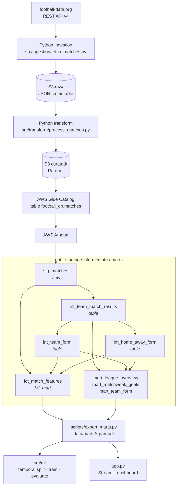

# Football Pipeline — ETL + ML on the Big 5 European Leagues

🇬🇧 English | 🇫🇷 [Français](README.fr.md)

[](https://gitlab.com/axelcorral-group/football-pipeline/-/pipelines)
[](https://gitlab.com/axelcorral-group/football-pipeline/-/pipelines)

A complete ELT pipeline that collects match data from the **Big 5 European leagues** via the football-data.org API, lands it on **AWS S3**, catalogues it in **Glue**, transforms it with **dbt on Athena** through a staging / intermediate / marts stack, then trains a **match outcome prediction** model (home win / draw / away win) served through a **Streamlit dashboard** deployable without AWS credentials.

> This project is not about predicting football accurately — the model is deliberately simple and its accuracy (43–49%) sits close to a naive baseline. Its purpose is to demonstrate the **end-to-end industrialization of a data pipeline** with the engineering practices expected in production.

## Live Demo

**https://football-pipeline-axel.streamlit.app**

The dashboard runs fully offline: it reads the dbt marts exported to Parquet and versioned in the repo (`data/marts/`) plus the pre-trained models in `models/`. No AWS credentials at runtime.

## Architecture



The boundary is deliberate. Python owns everything that talks to the outside
world — API calls, retries, rate limits, writing to S3 — plus everything that is
genuinely a modelling problem: the temporal split, training, evaluation,
inference. dbt owns everything that is a query: typing, cleaning, deduplication,
the H/D/A rule, team history, rolling windows, the feature dataset, the
analytics datasets — with tests, lineage and documentation attached.

**Orchestrator:** `python -m src.main` (with `--competition`, `--season`, `--dry-run`)
**Transformation layer:** `dbt build --project-dir dbt` — 8 models, 138 data tests
**GitLab CI/CD stages:** `lint` → `dbt` → `test` → `model` → `build` → `deploy`

## ML Results — 2025/26 season

Retained model: best of Logistic Regression and Random Forest, **temporal 80/20 split (no shuffle)**. Figures from `models/metrics.json`.

| League | Code | Model | Accuracy | Baseline (always H) | Gain | Log loss | Brier | n |
|--------|------|-------|---------:|--------------------:|-----:|---------:|------:|--:|
| Premier League | PL | Logistic Regression | 43.1% | 42.6% | +0.4 pt | 1.085 | 0.655 | 360 |
| Ligue 1 | FL1 | Logistic Regression | 46.6% | 46.1% | +0.5 pt | 1.056 | 0.642 | 286 |
| Bundesliga | BL1 | Logistic Regression | 46.6% | 43.8% | +2.8 pt | 1.080 | 0.651 | 288 |
| Serie A | SA | Logistic Regression | 48.6% | 38.9% | +9.7 pt | 1.057 | 0.637 | 356 |
| La Liga | PD | Logistic Regression | 49.3% | 48.9% | +0.3 pt | 1.009 | 0.605 | 355 |
| All leagues | all | Logistic Regression | 44.1% | 44.0% | +0.1 pt | 1.053 | 0.635 | 1645 |

> Football outcome prediction is a hard problem. Only Serie A shows a clear gain; elsewhere the model adds marginal value. Log loss sits just under ln(3) ≈ 1.099, meaning the predicted probabilities are barely more informative than a uniform draw. The value of this project is the pipeline and the ML lifecycle, not the model's raw performance. See [`models/model_card.md`](models/model_card.md) for full features, performance and limitations.

> **Moving the features to dbt did not change them.** On the 1,751 matches the two implementations share, the six rolling features produced by SQL are identical to the pandas ones within 1e-9. The accuracy differences against the previous run (Bundesliga 43.1% → 46.6%, all leagues 44.7% → 44.1%) come from one thing: rows are now ordered by `(match_date, match_id)` rather than by date alone, which moves the 80/20 boundary when several matches share a kick-off — six at once in the Bundesliga. The ordering is now total, so the split is reproducible.

## Data

| Parameter | Value |
|-----------|-------|
| Source | football-data.org API v4 (free tier) |
| Competitions | PL, FL1, BL1, SA, PD |
| Season | 2025/26 |
| Volume | ~1,750 raw matches collected, 1,644 usable rows after feature computation |
| Raw storage | S3 `raw/` — JSON per competition/date (immutable) |
| Curated storage | S3 `curated/` — Parquet partitioned by season |
| Transformation | dbt on Athena — 8 models, 138 data tests |
| Curated snapshot | `data/cache/matches_all_2025.parquet` (dbt source for the `dev` target) |
| Exported marts | `data/marts/*.parquet` — what the dashboard and training read |

## Stack

| Component | Technology |
|-----------|------------|
| Language | Python 3.12 · SQL |
| AWS | S3 · Glue Catalog · Athena |
| Transformation | dbt-core 1.11 · dbt-athena · dbt-duckdb · dbt_utils |
| AWS SDK | boto3 |
| Data | pandas · pyarrow (Parquet) · DuckDB (local dbt target) |
| ML | scikit-learn · joblib |
| Dashboard | Streamlit · Plotly |
| Tests | pytest · coverage ≥ 70% |
| Linting | flake8 · black |
| CI/CD | GitLab CI/CD |
| API source | football-data.org v4 |

## What This Project Demonstrates for a Data Engineer Role

This project is not about predicting football accurately — the model is
deliberately simple and its accuracy (43–49%) sits close to a naive baseline.
What it demonstrates is the ability to **industrialize a complete data pipeline
end to end**, with the engineering practices expected in production:

- **Ingestion** from an external REST API (football-data.org) with retry,
  backoff and rate-limit handling.
- **Structured cloud storage** on AWS S3 following a raw / curated lake pattern.
- **An ELT transformation layer in dbt** over Athena: staging, intermediate and
  marts, with 138 data-quality tests, lineage and generated documentation.
- **Temporal feature engineering without leakage**, built in SQL and asserted by
  tests that recompute the windows through an independent path.
- **Analytical querying** via AWS Athena (serverless SQL over S3 files).
- **A clean ML lifecycle**: training separated from serving, versioned model
  artifacts, tracked metrics, documented model card.
- **Automated CI/CD** on GitLab: linting, tests, coverage gate, build, deploy.
- **A deployed, reproducible dashboard** anyone can open and run.

The point is the infrastructure around the model — collecting, storing,
transforming, testing and deploying reliably — not the model's predictive
power. That distinction (Data Engineering vs Data Science) is intentional.

## Architecture Decisions

A few design choices worth explaining, because each was a deliberate tradeoff:

**dbt for transformation, Python for everything else.** Before dbt, "a team's
form over its last five matches" lived in three places: `src/ml/features.py` for
training, an ad-hoc reconstruction in `app.py` for the prediction page, and three
standalone SQL files for analytics. Three implementations, three chances to
diverge, and no test able to notice. dbt puts that logic in one place, in SQL,
next to the data — and adds tests, lineage and documentation to it. Python keeps
what it is better at: talking to the API, writing to S3, and the modelling
itself. See [`docs/dbt.md`](docs/dbt.md).

**Raw / curated separation on S3.** The `raw/` zone holds the data exactly as
the API returned it (untouched JSON) and is treated as immutable. The `curated/`
zone holds the cleaned, transformed Parquet that the model and dashboard consume.
If a bug is found in the transformation logic, the pipeline can be replayed from
the intact `raw/` data without ever re-hitting the API. Separating immutable
source data from processed data is the foundation of a data lake.

**S3 + Athena instead of a managed database.** The data is collected in batch and
queried occasionally for analytics — it does not change continuously. A
permanently running database (e.g. PostgreSQL) would mean paying for idle compute.
With S3 + Athena, storage costs cents and queries are billed only when run
(serverless analytics). The right tool for batch analytical workloads on
slowly-changing data.

**Pre-trained models committed to the repo, not retrained on startup.** The
dashboard loads pre-trained `.joblib` artifacts instead of retraining the model on
each visit. This makes page loads fast, calls the training data only once (at
build time) instead of on every user visit, and cleanly separates the training
phase from the serving phase — the standard structure of any production ML system.

**One model per league rather than a single global model.** Each championship has
its own characteristics and dynamics, which produce genuinely different predictive
patterns (Serie A gains +9.7 points over baseline, Bundesliga is slightly
negative). A per-league model preserves this granularity; a single global model
would dilute league-specific signal. A global `all` model is also trained and
kept, for the combined view.

## Model Lifecycle & Reproducibility

The ML workflow is built to be traceable and reproducible, not a black box:

- **Training is a dedicated, explicit step** (`scripts/train_all_models.py`),
  never triggered implicitly by the dashboard.
- **Temporal 80/20 split, no shuffle.** Because matches are time-ordered, the
  oldest 80% are used for training and the most recent 20% for testing. A random
  shuffle would let the model "see" future matches during training and silently
  leak information — inflating accuracy that would collapse in practice. The
  temporal split prevents this.
- **Anti-leakage features.** A team's form for match M is the form row whose
  rank equals the number of matches it had played *strictly before* M. The match
  can therefore never enter its own window, and neither can a later one. Ranking
  played matches — rather than framing over rows — keeps this exact when
  postponed or future fixtures sit in the middle of a calendar. The mart exposes
  `home_form_as_of` / `away_form_as_of`, and four dbt tests assert the property
  on every build, one of them by recomputing the windows through an independent
  path. See [`docs/dbt.md`](docs/dbt.md#absence-de-fuite-temporelle).
- **Tracked metrics.** Every training run writes `models/metrics.json` (accuracy,
  baseline, gain, retained model, training date, row count per league), so it is
  always clear which model is running and how it performed.
- **A model card** (`models/model_card.md`) documents intended use, features,
  per-league performance and — importantly — the model's known limitations
  honestly.

Reproduce the full model set with:

```bash
python scripts/train_all_models.py
```

## Project Structure

```
football-pipeline/
├── app.py                          # Streamlit dashboard (4 pages)
├── requirements.txt                # Core pipeline dependencies (pinned)
├── requirements-dev.txt            # Dev/test/CI dependencies
├── requirements_app.txt            # Streamlit-only dependencies
├── .gitlab-ci.yml                  # lint → test → model → build → deploy
├── pyproject.toml                  # black & pytest config
├── README_DEPLOY.md                # Streamlit Cloud deployment notes
│
├── dbt/                            # Transformation layer (see docs/dbt.md)
│   ├── dbt_project.yml
│   ├── profiles.yml                # 3 targets: dev (DuckDB) · dev_s3 · athena
│   ├── packages.yml                # dbt_utils
│   ├── macros/form_frame.sql       # the rolling window, defined once
│   ├── models/
│   │   ├── staging/                # sources.yml · stg_matches
│   │   ├── intermediate/           # int_team_match_results · int_team_form
│   │   │                           # int_home_away_form
│   │   └── marts/
│   │       ├── ml/                 # fct_match_features
│   │       └── analytics/          # mart_league_overview · mart_matchweek_goals
│   │                               # mart_team_form
│   └── tests/                      # 3 singular tests, incl. temporal leakage
│
├── src/
│   ├── main.py                     # ETL orchestrator (CLI + --dry-run)
│   ├── config/                     # .env loading & Config dataclass
│   ├── ingestion/
│   │   └── fetch_matches.py        # API fetch + retry + S3 JSON upload
│   ├── transform/
│   │   ├── process_matches.py      # load_raw_from_s3 · transform · save_as_parquet
│   │   └── glue_transform.py       # GlueTransformer (pandas Glue-like)
│   ├── load/
│   │   └── s3_loader.py            # Upload Parquet → S3
│   ├── marts.py                    # Where the exported dbt marts live
│   ├── ml/
│   │   ├── features.py             # Loads fct_match_features → model matrix
│   │   ├── train.py                # LR vs RF · temporal 80/20 split · joblib
│   │   ├── inference.py            # Pre-trained model loading (serving)
│   │   └── evaluate.py             # Naive baseline · log loss · Brier
│   ├── query/
│   │   └── athena_query.py         # AthenaQueryRunner
│   ├── analytics/
│   │   └── athena_queries.py       # Business analytical queries
│   └── utils/
│       └── logger.py               # Structured logger
│
├── scripts/
│   ├── ingest_all.py               # Ingest 5 competitions × N seasons
│   ├── export_cache.py             # S3 raw → data/cache/ (curated snapshot)
│   ├── export_marts.py             # dbt marts → data/marts/ (Parquet)
│   └── train_all_models.py         # Train 5 per-league models + global + metrics.json
│
├── models/
│   ├── match_predictor_{PL,FL1,BL1,SA,PD,all}.joblib   # Versioned models
│   ├── metrics.json                # Accuracy/baseline/gain/date/n per league
│   └── model_card.md               # Model card (use, features, limitations)
│
├── data/
│   ├── cache/                      # Curated snapshot — dbt source for `dev`
│   │   ├── matches_all_2025.parquet
│   │   └── matches_{PL,FL1,BL1,SA,PD}_2025.parquet
│   └── marts/                      # Exported dbt marts (offline app + training)
│       ├── fct_match_features.parquet
│       ├── mart_team_form.parquet
│       ├── mart_league_overview.parquet
│       └── mart_matchweek_goals.parquet
│
└── tests/
    ├── conftest.py
    ├── test_extract.py
    ├── test_ingestion.py           # fetch_matches + fetch_all_competitions
    ├── test_transform.py
    ├── test_load.py
    ├── test_ml.py                  # mart loading · model matrix · train · metrics
    ├── test_marts.py               # export + contract of data/marts/
    ├── test_analytics.py           # Athena result type coercion
    ├── test_main.py                # orchestrator (dry-run, CLI, error handling)
    └── test_query.py
```

## Installation

```bash
python -m venv .venv

# Windows
.venv\Scripts\activate
# Linux / macOS
source .venv/bin/activate

pip install -r requirements.txt -r requirements-dev.txt
cp .env.example .env   # then fill in the variables
```

dbt lives in its own environment — it pins its own `jinja2`, `click` and
`protobuf`, and mixing those into `requirements.txt` would needlessly constrain
Streamlit and the ETL pipeline:

```bash
python -m venv .venv-dbt
.venv-dbt\Scripts\activate        # Windows
source .venv-dbt/bin/activate      # Linux / macOS
pip install -r requirements-dbt.txt
```

## Usage

### Full pipeline (orchestrator)

```bash
python -m src.main                         # 5 competitions
python -m src.main --competition PL        # single competition
python -m src.main --dry-run               # simulation, no API/S3 call
```

### dbt — the transformation layer

Run every dbt command **from the repository root**: dbt does not change working
directory, so relative paths in the profile and in the sources resolve from
there.

```bash
export DBT_PROFILES_DIR=$PWD/dbt           # $env:DBT_PROFILES_DIR = "$PWD\dbt" on PowerShell

dbt deps    --project-dir dbt                  # install dbt_utils
dbt debug   --project-dir dbt --target dev     # check the connection
dbt parse   --project-dir dbt --target athena  # validate the project, no AWS needed
dbt compile --project-dir dbt --target dev     # compiled SQL under dbt/target/
dbt build   --project-dir dbt --target dev     # models + tests
dbt test    --project-dir dbt --target dev     # tests only
dbt docs generate --project-dir dbt --target dev
dbt docs serve    --project-dir dbt            # DAG + column-level docs
```

Three targets share the same models:

| Target | Engine | Source | Credentials |
|--------|--------|--------|-------------|
| `dev` | DuckDB | `data/cache/matches_all_*.parquet` (committed snapshot) | none |
| `dev_s3` | DuckDB | `s3://…/curated/*/*/matches.parquet` | S3 read |
| `athena` | Athena | Glue table `football_db.matches` | Athena + Glue + S3 |

The DuckDB targets are not a toy: they run the same 8 models and the same 138
tests on the same data, which is what lets CI verify the data-quality layer on
every commit without credentials or an Athena bill.

### Exporting the marts

The deployed dashboard has no AWS access, so the marts are exported to Parquet
and committed:

```bash
python scripts/export_marts.py --source duckdb   # from a local dbt build
python scripts/export_marts.py                   # from Athena
```

### Model training

```bash
python scripts/train_all_models.py         # 5 per-league models + global + metrics.json
```

Training reads `data/marts/fct_match_features.parquet` and computes no features
of its own.

### Streamlit dashboard

```bash
pip install -r requirements_app.txt
streamlit run app.py
```

### Tests & Linting

```bash
pytest tests/ -v
pytest tests/ --cov=src --cov-report=term-missing   # with coverage
flake8 src/ tests/ --max-line-length 100
black src/ tests/
```

## Environment Variables

See `.env.example` for the full template.

| Variable | Description |
|----------|-------------|
| `API_KEY` | football-data.org API key |
| `FOOTBALL_API_BASE_URL` | API base URL (default: `https://api.football-data.org/v4`) |
| `AWS_BUCKET_NAME` | Target S3 bucket |
| `AWS_REGION` | AWS region (default: `eu-west-1`) |
| `ATHENA_DATABASE` | Athena database holding the source table `matches` |
| `ATHENA_OUTPUT_S3` | S3 URI for Athena results |
| `DBT_ATHENA_SCHEMA` | Schema dbt materialises into — never the source database |
| `DBT_TARGET` | Default dbt target (`dev`, `dev_s3`, `athena`) |
| `ATHENA_WORKGROUP` | Athena workgroup used by dbt |
| `DBT_SOURCE_MATCHES` | Override for the DuckDB targets' source path |

> AWS credentials (`AWS_ACCESS_KEY_ID`, `AWS_SECRET_ACCESS_KEY`) are read from `~/.aws/credentials` or the environment — never stored in `.env`.

## Known Limitations

- **Single season**: football-data.org's free tier does not support the `season` filter — the data only covers the current season (2025/26).
- **Simple features**: rolling 5-match average (goals, points) without xG, FIFA/UEFA ranking, or player-level data.
- **Small per-league samples**: 285 to 360 training rows per competition — the test set (~57 to ~72 matches) makes accuracy differences statistically weak.
- **No temporal cross-validation**: a single 80/20 split, with no variance estimate (walk-forward / expanding window).
- **Negative gain on Bundesliga**: the model performs worse there than the naive "always home win" baseline.
- **football-data.org data**: some fields are missing depending on the competition — `referee` is absent on 32 matches, and `venue` is empty on all of them, so `stg_matches` does not carry it.
- **The Athena target has not been executed**: the project's IAM user has S3 read/write but no Athena or Glue permission. The models were validated against the real curated zone through the `dev_s3` target, which reads exactly the Parquet files the Glue table points at. A dialect divergence between DuckDB and Trino would only surface on the first `dbt build --target athena`.
- **No incremental models**: one season of the Big 5 is ~1,750 matches, under a megabyte of Parquet. A full refresh scans less than Athena's billing minimum, so incremental processing would add a `unique_key`, late-arriving-data handling and drift risk for no measurable gain. See [`docs/dbt.md`](docs/dbt.md#matérialisations).
